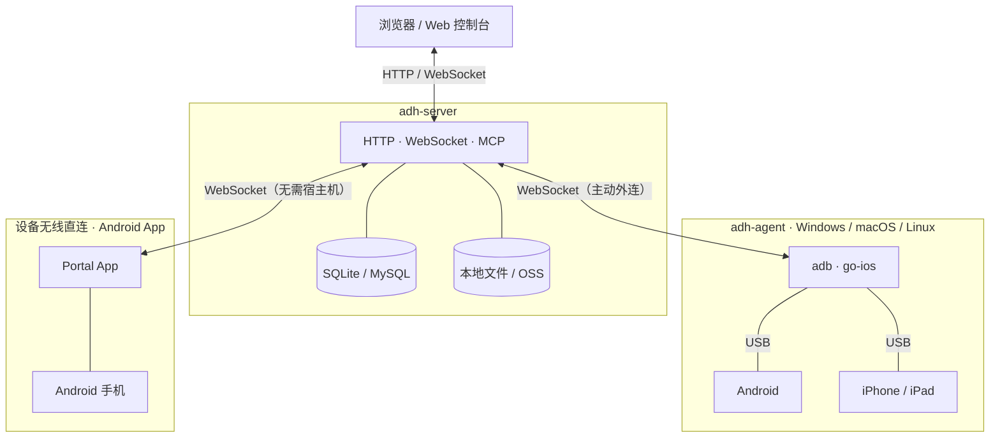

# ADH · 分布式设备农场

把分散在多台电脑上的 Android / iOS 真机集中到一个 Web 控制台：实时投屏、直接操作、批量执行、AI 自动化。

## 架构



三种接入方式：

| 方式 | 适用 | 依赖 |
| --- | --- | --- |
| **内置 Agent** | 单机部署，手机直接插服务器 | 无 |
| **adh-agent** | 分布式，每台插手机的电脑跑一个 | USB + adb / go-ios |
| **设备无线直连** | Android 手机装 App 即可接入 | 无宿主机、无 USB |

一个 server 可接任意多个 agent，每个 agent 可接多台设备；设备也可以直接以 App 形式连进来。

## 核心能力

- **投屏与控制**：Android 走 scrcpy / MediaProjection，iOS 走 WDA；触摸、滑动、按键、文本输入、旋转
- **AI 自动化**：自然语言操作设备，纯视觉闭环（截图 → 决策 → 动作 → 校验），支持单台与批量任务
- **批量控制**：多设备网格、跨设备联动、批量安装、任务可随时停止
- **应用与文件**：APK / IPA 上传、图标解析、一键安装；设备文件浏览、上传、下载
- **MCP 接入**：内置 Streamable HTTP MCP，直接接入 Codex / Claude Code / Cursor 等客户端
- **权限与审计**：三角色、设备锁定、操作日志、任务回放

## 快速开始（单机）

server 自带内置 Agent，插上手机就能用。

**1. 启动**

从 [Release](https://github.com/ZhouQQQ/adh/releases) 下载对应平台的离线包，目标机只需 **Node.js 22+**：

```bash
unzip adh-server-linux.zip     # Windows 用 adh-server-win32.zip
cd server-linux && ./start.sh
```

**2. 打开控制台**

访问 `http://127.0.0.1:8080`，默认账号 `admin / admin`，登录后立即修改密码。

**3. 接入设备**

- Android：开发者选项 → 开启「USB 调试」「USB 安装」→ 插线后允许调试
- iOS：插线后「信任此电脑」→ 设备菜单点「启动 WDA」

改端口或数据目录：

```bash
./start.sh --port 9000 --data /var/lib/adh
```

## 分布式部署

server 跑在服务器，每台插手机的电脑跑一个 adh-agent（主动外连，不需要公网 IP）。

**1. 启动 server**

```bash
docker run -d --name adh \
  -p 8080:8080 \
  -v adh-data:/data \
  -e ADH_DATA_DIR=/data \
  -e ADH_LOCAL_AGENT=0 \
  --restart unless-stopped \
  ghcr.io/zhouqqq/adh:latest
```

国内镜像：`registry.cn-shenzhen.aliyuncs.com/xiaoantest/adh-server:latest`

> `-v` 不要去掉，所有数据都在这个卷里；服务器没有 USB，用 `ADH_LOCAL_AGENT=0` 关掉内置 Agent。

**2. 创建 Agent Key**

控制台 →「节点管理」→「新建节点」→ 复制 `adh_` 开头的 Key（只显示一次）。

**3. 启动 Agent**

从 Release 下载（已内置 adb / go-ios），或在控制台点「下载 Agent」：

```bat
:: Windows
cd C:\adh-agent
adh-agent.cmd connect --server ws://<服务器IP>:8080 --key adh_xxxxxxxx
```

```bash
# macOS / Linux
cd /opt/adh-agent
./adh-agent.sh connect --server ws://<服务器IP>:8080 --key adh_xxxxxxxx
```

首次 `connect` 会自动把内置的 adb / go-ios 解压到 `~/.adh/tools`。

**更新 Agent**：

```bash
adh-agent update --check      # 只检查版本
adh-agent update              # 下载、校验、原地替换并重启
adh-agent update --rollback   # 回退上一版本
```

更新只替换代码目录，保留 `vendor/` 和 `~/.adh` 配置；旧版本备份为 `<install>.bak-*`。

其他：Key 存在 `~/.adh/agent.json`；macOS 提示"无法验证开发者"用 `xattr -dr com.apple.quarantine`；Windows 的 iOS 17+ 隧道依赖内置的 `wintun.dll`。

## 设备无线直连（Android）

不依赖宿主机，手机装一个 App 即可被控制台接管。

1. 控制台 →「设备管理」→ 点「设备无线直连」卡片
2. 手机扫码下载 APK，或直接扫描第 3 步的连接二维码
3. 依次授权：屏幕录制、无障碍、默认输入法、所有文件、修改系统设置、通知、位置、安装未知应用、忽略电池优化、自启动

授权完成后 App 自动连接，控制台可见设备。**只有真正拿到投屏授权才会建立连接**，系统停止共享时会自动断开并在 App 里引导重新授权。

局限：iOS 不允许第三方 App 注入触摸到其他 App，无法做设备内直连，需宿主 Agent + WDA。

## 配置

| 环境变量 | 默认值 | 说明 |
| --- | --- | --- |
| `ADH_PORT` | `8080` | 监听端口 |
| `ADH_DATA_DIR` | `.data` | 数据目录 |
| `ADH_LOCAL_AGENT` | `1` | 设为 `0` 关闭内置 Agent |
| `ADH_DB` | `sqlite` | `sqlite` / `mysql` |
| `ADH_STORAGE` | `local` | `local` / `oss` |
| `ADH_BASE_PATH` | 空 | 部署前缀，例如 `/adh` |

外接 MySQL / OSS 时写好 `.env`，启动加 `--env-file .env`：

```bash
MYSQL_HOST=192.168.1.20
MYSQL_PORT=3306
MYSQL_USER=adh
MYSQL_PASSWORD=你的密码
MYSQL_DB=adh

ADH_OSS_BUCKET=your-bucket
ADH_OSS_REGION=oss-cn-shenzhen
ADH_OSS_ACCESS_KEY_ID=xxx
ADH_OSS_ACCESS_KEY_SECRET=xxx
```

## MCP 接入

侧边栏「系统 → MCP 接入」，系统为每个用户维护一把 `adhk_` 开头的 Key。

```json
{
  "mcpServers": {
    "ADH 设备农场": {
      "url": "http://<服务器IP>:8080/mcp?key=adhk_xxx"
    }
  }
}
```

工具：`list_devices`、`get_device`、`run_task`、`batch_task`、`get_task`、`list_tasks`、`cancel_task`、`cancel_all_tasks`。

## 本地开发

```bash
pnpm install
pnpm dev                                # server:8080 + web:5173
pnpm typecheck                          # 全量类型检查
pnpm build                              # 前端产物到 apps/server/public
pnpm start                              # 单进程托管 API + 前端

pnpm package:agent                      # 三平台 Agent 包
pnpm package:server --platform linux    # server 包（自动带上 APK）
pnpm portal:build                       # Android 直连 App（JDK 17 + SDK 34）
```

构建直连 App 需要 JDK 17 与 Android SDK 34，产物在 `apps/portal-android/app/build/outputs/apk/debug/app-debug.apk`。

```
apps/server/          API、WebSocket、MCP、内置 Agent
apps/agent/           宿主机守护进程
apps/web/             Vue 3 控制台
apps/portal-android/  Android 设备直连 App（Kotlin）
packages/protocol/    消息 schema、二进制帧、H.264 工具
packages/device-host/ adb / scrcpy / iOS 采集
```

## 常见问题

| 现象 | 处理 |
| --- | --- |
| 控制台打不开 | `curl http://<IP>:8080/api/health`，检查容器与防火墙 |
| Agent 连不上 | 宿主机执行同样的 health 检查 |
| 设备不出现 | `adb devices` 要显示 `device` 而不是 `unauthorized` |
| 局域网 IP 打开没画面 | WebCodecs 要求安全上下文，改用 `localhost` 或配 HTTPS |
| 直连 App 装不上 | vivo/iQOO 需在应用信息右上角「解除限制」；小米关安全模式；华为关纯净模式 |
| 小米能投屏但点不动 | 打开「USB 调试（安全设置）」，需登录小米账号并等待 7 天 |

## 说明

- 内网工具，请部署在可信网络，不要直接暴露到公网
- 写操作记入审计日志；设备控制、安装、文件操作记入设备日志
- iOS 的 WiFi SSID 系统不开放，只能显示 IP
