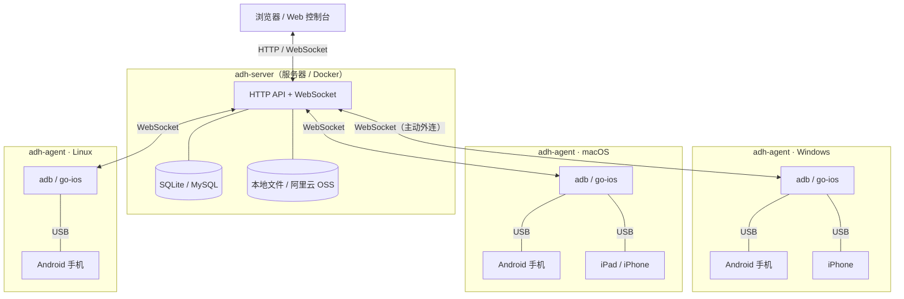

# ADH · 分布式设备农场

把分散在多台电脑上的 Android / iOS 真机集中到一个 Web 控制台：实时投屏、直接操作、批量安装。

## 架构



- **adh-server**：Web 控制台 + 设备调度，部署在一台服务器上
- **adh-agent**：装在插着手机的电脑上，主动外连 server，不需要公网 IP
- 一个 server 可以接任意多个 agent，每个 agent 可以接多台 Android / iOS 设备

## 功能

- **投屏与控制**：scrcpy（Android）、WDA（iOS），触摸、滑动、缩放、按键、文本输入
- **应用管理**：APK / IPA 上传、图标解析、一键安装
- **文件管理**：浏览、上传、下载、打包 zip
- **批量控制**：多设备网格、跨设备联动、批量安装
- **AI 助手**：控制者可用自然语言多轮对话操作设备，纯视觉闭环（截图 → 决策 → 动作 → 再截图校验），支持点击、滑动、输入和按键；模型在系统设置里配置
- **MCP / 外部 Agent**：服务端内置 Streamable HTTP MCP（`/mcp?key=adhk_xxx`），把设备农场接入 Codex、Claude Code、Cursor 等客户端；外部 agent 可创建异步任务并查询结果。入口在侧边栏「系统 → MCP 接入」，所有登录用户都可以生成自己的 Key
- **设备信息**：电量、内存、存储、网络、硬件参数
- **权限与审计**：三角色、设备锁定、操作日志

---

## 快速开始（单机）

server 自带内置 Agent，插上手机就能用。

**1. 下载并启动**

从 [Release](https://github.com/ZhouQQQ/adh/releases) 下载对应平台的离线包，目标机只需要 **Node.js 22+**：

```bash
unzip adh-server-linux.zip     # Windows 用 adh-server-win32.zip / start.cmd
cd server-linux
./start.sh
```

**2. 打开控制台**

浏览器访问 `http://127.0.0.1:8080`，默认账号 `admin / admin`，登录后立即修改密码。

**3. 插上手机**

- Android：连续点「版本号」7 次打开开发者选项 → 开启「USB 调试」「USB 安装」→ 插线后点「允许 USB 调试」
- iOS：插线后点「信任此电脑」→ 设备菜单里点「启动 WDA」

改端口或数据目录：

```bash
./start.sh --port 9000 --data /var/lib/adh
```

---

## 分布式部署

server 跑在服务器（Docker），每台插手机的电脑跑一个 Agent。

### 1. 启动 server

```bash
docker run -d --name adh \
  -p 8080:8080 \
  -v adh-data:/data \
  -e ADH_DATA_DIR=/data \
  -e ADH_LOCAL_AGENT=0 \
  --restart unless-stopped \
  ghcr.io/zhouqqq/adh:latest
```

国内可用：`registry.cn-shenzhen.aliyuncs.com/xiaoantest/adh-server:latest`

- 数据都在 `adh-data` 卷里，**不要去掉 `-v`**
- 服务器上没有 USB，所以用 `ADH_LOCAL_AGENT=0` 关掉内置 Agent
- 启动日志会打印访问地址和初始账号

### 2. 创建 Agent Key

控制台 →「节点管理」→「新建节点」→ 复制 `adh_` 开头的 Key（只显示一次）。

### 3. 在设备宿主机运行 Agent

从 [Release](https://github.com/ZhouQQQ/adh/releases) 下载（已内置 adb 和 go-ios），或在控制台点右上角「下载 Agent」：

| 平台 | 文件 |
| --- | --- |
| Windows | `adh-agent-win32.zip` |
| macOS | `adh-agent-darwin.zip` |
| Linux | `adh-agent-linux.zip` |

**Windows**：

```bat
cd C:\adh-agent
adh-agent.cmd connect --server ws://<服务器IP>:8080 --key adh_xxxxxxxx
```

**macOS / Linux**：

```bash
cd /opt/adh-agent
chmod +x adh-agent.sh
./adh-agent.sh connect --server ws://<服务器IP>:8080 --key adh_xxxxxxxx
```

首次 `connect` 会自动把安装包内置的 adb / go-ios 解压到 `~/.adh/tools`，不需要先执行 `init`（想提前安装也可以手动运行 `adh-agent init`）。

看到 `adh-agent started` 就成功了。多台宿主机重复第 2、3 步即可。

**更新 Agent**：

```bat
adh-agent.cmd update --check     :: 只检查版本
adh-agent.cmd update             :: 下载、校验、原地替换并自动重启
adh-agent.cmd update --rollback  :: 回退到上一版本
```

更新只替换代码目录，保留 `vendor/` 内置 adb / go-ios 与 `~/.adh` 下的连接配置；
旧版本备份在安装目录同级的 `*.bak-*`，更新期间设备会短暂断开。
内网访问不了 GitHub 时用 `--source http://<镜像>/adh-agent-manifest.json`，
或把 zip 拷到宿主机执行 `adh-agent.cmd update --from-file adh-agent-win32.zip`。
macOS / Linux 把 `adh-agent.cmd` 换成 `./adh-agent.sh` 即可。

- Key 保存到 `~/.adh/agent.json`，之后重启只带 `--server`
- macOS 提示「无法验证开发者」：`xattr -dr com.apple.quarantine /opt/adh-agent`
- iOS 接在任意宿主机上都可以，在设备菜单里启动 WDA 即可；Windows 需先装 iTunes 或「Apple Devices」
- Windows 的 iOS 17+ 隧道依赖 `wintun.dll`，安装包已内置并自动放到 go-ios 同目录；普通权限会用 `--userspace` 模式
- 开机自启、WDA 安装等细节见 [`docs/agent-install.md`](docs/agent-install.md)

### 4. 外接 MySQL / OSS（可选）

默认 SQLite + 本地文件就够用。需要外接时写好 `.env`，启动加 `--env-file .env`：

```bash
MYSQL_HOST=192.168.1.20
MYSQL_PORT=3306
MYSQL_USER=adh
MYSQL_PASSWORD=你的密码
MYSQL_DB=adh

ADH_OSS_BUCKET=your-bucket
ADH_OSS_REGION=oss-cn-shenzhen
ADH_OSS_ACCESS_KEY_ID=xxx
ADH_OSS_ACCESS_KEY_SECRET=xxx
ADH_OSS_PREFIX=adh
```

### 5. 可选参数

| 环境变量 | 默认值 | 说明 |
| --- | --- | --- |
| `ADH_PORT` | `8080` | 监听端口 |
| `ADH_DATA_DIR` | `.data` | 数据目录 |
| `ADH_LOCAL_AGENT` | `1` | 设为 `0` 关闭内置 Agent |
| `ADH_DB` | `sqlite` | `sqlite` / `mysql` |
| `ADH_STORAGE` | `local` | `local` / `oss` |
| `ADH_BASE_PATH` | 空 | 部署前缀，例如 `/adh` |

---

## 常见问题

| 现象 | 处理 |
| --- | --- |
| 控制台打不开 | `docker ps` 看容器在不在，`curl http://<服务器IP>:8080/api/health` |
| 忘记密码 | 默认 `admin / admin`；进不去就删掉数据卷重新初始化 |
| Agent 连不上 server | 在宿主机 `curl http://<服务器IP>:8080/api/health`，检查防火墙 |
| 设备不出现 | 宿主机执行 `adb devices`，要显示 `device` 而不是 `unauthorized` |
| 小米能投屏但点不动 | 打开「USB 调试（安全设置）」，需登录小米账号并等待 7 天 |
| 密码框弹不出键盘 | 关掉厂商的「安全输入」，并确认启用了输入法 |

---

## 本地开发

```bash
pnpm install
pnpm dev                                # server:8080 + web:5173（HTTP）
pnpm build                              # 前端产物到 apps/server/public
pnpm start                              # 单进程托管 API + 前端
pnpm package:agent                      # 打三平台 Agent 包
pnpm package:server --platform linux    # 打离线 server 包
```

默认走 HTTP；需要 HTTPS（例如用局域网 IP 访问、要求 WebCodecs 安全上下文）时用 `ADH_HTTPS=1 pnpm dev`。

```
apps/server/          API、WS、内置 Agent、OSS
apps/agent/           宿主机守护进程
apps/web/             Vue 控制台
packages/protocol/    消息 schema、H.264 工具
packages/device-host/ adb / scrcpy / iOS 采集
docs/                 设备接入与部署文档
```

## 说明

- 内网工具，请部署在可信网络，不要直接暴露到公网
- 写操作自动记入审计日志；设备控制、安装、文件操作记入设备日志
- iOS 的 WiFi SSID 系统不开放，只能显示 IP
